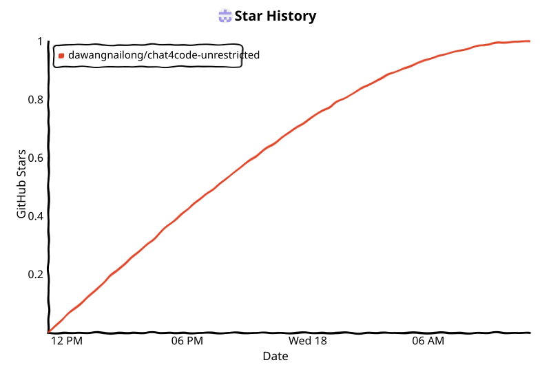

  

<h1 align="center">chat4code-unrestricted</h1>

  一个静态 DeepSeek 聊天前端 
  <a href="https://dawangnailong.github.io/chat4code-unrestricted/">在线版</a> ·
  <a href="https://github.com/dawangnailong/chat4code-unrestricted">仓库</a> ·
  <a href="https://github.com/dawangnailong/opencode-bridge">OpenCode Bridge</a>

> 这是 `xiaohuangbo/chat-demo-unrestricted` 的 fork。完整功能、设置项、请求体、实现索引与已知限制，见[上游 README](https://github.com/xiaohuangbo/chat-demo-unrestricted/blob/main/README.zh-CN.md)。
>
> 下面只写三条我们自己的判断。第一条已经落到推荐路径上，第二条是我们正在收敛的方向，第三条是规划。

---

## 1. 低成本聊天服务，应受到支持

### 1.1 免费聊天限额之后

2026 年 11 月 16 日起，多家媒体报道 DeepSeek 免费 App/网页聊天出现限制：超过 7 天不活跃的长对话不能继续、单次输入约 4 万字上限、每日对话额度（用尽时提示“因服务器繁忙，使用额度已达上限”）。截至报道时没有官方统一公告；限制只影响消费端，API 不受影响。据同期报道，消费端没有可升级的付费聊天档位，唯一付费路径是开发者 API。

来源：[光明网](https://m.gmw.cn/2026-11/16/content_1304586782.htm)、[新浪财经](https://finance.sina.com.cn/wm/2026-11-16/doc-iniyxcif2449372.shtml)、[什么值得买的 DeepSeek 计费拆解](https://post.smzdm.com/p/a826qpv6/)（第三方分析，仅供参考）。

### 1.2 “去用 API”并不便宜

官方价格页：[DeepSeek API Pricing](https://api-docs.deepseek.com/quick_start/pricing)。下表为美元/百万 token，谷时 / 峰时；峰时 = 谷时 ×2，峰时为北京时间工作日 09:00–12:00、14:00–18:00。

| 模型 | 缓存命中 | 输入（未命中） | 输出 |
|---|---:|---:|---:|
| `deepseek-flash` | $0.003 / $0.006 | $0.15 / $0.30 | $0.60 / $1.20 |
| `deepseek-v4-pro` | $0.022 / $0.044 | $0.66 / $1.32 | $1.98 / $3.96 |

～～一次 30 轮、平均上下文 20K、每轮输出 1K、80% 缓存命中的 V4 Pro 聊天：输入 600K（480K 缓存 + 120K 未命中），输出 30K。按官方美元价 ×7.2 估算：

- 谷时：480K×$0.022 + 120K×$0.66 + 30K×$1.98（每百万 token）≈ $0.149 ≈ **1.07 元**；
- 峰时 ×2 ≈ **2.15 元**。~~ todo 1 

已经是一个加工的鸡蛋食品的价格，这不合理。

在聊天中的典型**角色扮演**场景：～～人设卡、世界观、长历史、长回复。按下面的假设算（人民币按 1 USD ≈ 7.2 CNY 估算；问答按 80% 缓存命中，RP 因为设定/历史变化按 50% 算）：

| 场景 | 每日轮数 | 平均上下文 | 每日输入 | 每日输出 | 缓存命中 | V4 Pro 谷时/天 | Flash 谷时/天 |
|---|---:|---:|---:|---:|---:|---:|---:|
| 轻度问答 | 20 | 8K | 160K | 10K | 80% | ≈0.32 元 | ≈0.08 元 |
| 标准问答 | 50 | 20K | 1M | 50K | 80% | ≈1.79 元 | ≈0.45 元 |
| 角色扮演 | 100 | 50K | 5M | 150K | 50% | ≈14.4 元 | ≈3.4 元 |
| 重度角色扮演 | 200 | 80K | 16M | 400K | 50% | ≈45.0 元 | ≈10.5 元 |

**“一天聊出几十块”不是空穴来风**：V4 Pro 标准 RP 峰时约 29 元/天；重度 RP 谷时约 45 元/天、峰时约 90 元/天。Flash 便宜得多，但标准 RP 也要 3.4 元/天（谷时）/ 6.8 元/天（峰时），重度 10.5 / 21 元/天。应用内有每日费用提醒（默认 10 元，只提示不拦截），RP 场景建议按自己的预算调整，不要把它当摆设。

补充：2026-11-18 12:00（北京时间）起，模型调用中触发的服务端搜索/抓取不再单独计费，只算 token；纯聊天会便宜一点，但不改变长上下文 + 深度思考的成本结构。

聊天也并不天然比 agent 便宜：长上下文、深度思考、搜索都按 token 计费；agent 只是把这些 token 花在能完成任务的地方。所以“聊天用户就该去用 API”并不是一个省钱建议。～～todo 2 todo12 对成本估计并不令人满意。比如刚刚的完全重写 readme 任务，3 元多，我不相信是我的做法错了，或者是本应昂贵的。网络上建议的 deepseek harness 本身就不是聊天的好选择，另外我希望能收益的那些人比如“许肃”那个（https://www.sina.cn/news/detail/5366018630227784.html，https://pic2.zhimg.com/v2-3b01540297cb43522435380449b74977_1440w.jpg， http://wx1.sinaimg.cn/middle/6dd57921ly1ij4fu87rejj20te1ks1bl.jpg），他们的使用，以及 deepseek-harness(及 go)（https://github.com/ccch1mneyyy/dsh-go， https://github.com/deepseek-ai/deepseek-harness）的简单使用问答超过 元 的量级我认为是可能的，而日常使用。。。opencode go api 可以给压到比如 1/5 的成本考虑到缓存策略，api 差异等，并且避免中转站恶意行为，我认为是很有意义的，值得的。

### 1.3 “为什么不在谷时用”不是答案

峰时是工作日 09:00–12:00、14:00–18:00；其余时间才是谷时，包括晚上、周末和节假日。要求聊天用户按 API 折扣时段安排生活，不是产品方案。对普通用户来说，“去用 API”和“为什么不在谷时用”都不构成一个可用的方案。

### 1.4 我们在推的路径：OpenCode Go + opencode-bridge

OpenCode Go：**$10/月**；Go Plus：**$40/月**；Go Teams：**$20/人/月**（2 人起）。Go 的“只用某个模型”的月度额度：DeepSeek V4.1 Flash 1017（应用里的 `deepseek-flash`）= **$100**，DeepSeek V4 Pro = **$15**；Plus 分别为 $200 / $60。额度按 5 小时 20%、每周 50%、每月 100% 释放，所有付费模型共用一个池。

按 7.2 汇率，$10 ≈ **72 元/月**：30 天摊 **2.4 元/天**，22 个使用日摊 **3.3 元/天**。这就是“3 元整天”的来源——是订阅摊薄，不是单次请求单价。$100 的 Flash 月度额度，按 $0.15/M 输入价折算约 **6.66 亿输入 token**（只算输入的上限）；5 小时窗口的 $20 ≈ 1.33 亿输入 token，远高于聊天用量。

按“标准”问答用量（50 轮/天、1M 输入、50K 输出、80% 缓存）：V4 Pro 每天约 $0.25（约 1.8 元），$15 月额度够一个人用满一个月；Flash 每天约 $0.06（约 0.45 元）。

角色扮演才是额度压力测试：标准 RP（100 轮、5M 输入、150K 输出、50% 缓存）用 Flash 每天约 $0.47（约 3.4 元），一个月约 $14，$100 额度覆盖；重度 RP（200 轮、16M 输入、400K 输出）每天约 $1.46（约 10.5 元），一个月约 $44，仍在 $100 内。用 V4 Pro：标准 RP 约 $2.0/天，一个月约 $60，超过 Go 的 $15，正好卡 Go Plus 的 $60；重度 RP 约 $6.25/天，一个月约 $187，Go Plus 也不够。RP 的低成本路径是 Flash；V4 Pro RP 走按量或 Go Plus + Extra Usage。

**但 Go 不是无条件最便宜。** 按“标准”问答的 V4 Pro 用量，按量 API 一个月约 54 元，低于 Go 的 72 元；但角色扮演会迅速反超——V4 Pro 标准 RP 一个月约 430 元，Flash 标准 RP 约 100 元，Go 的封顶价值这时才明显。Go 买的是成本封顶、不用盯 token 和多模型额度；轻度/标准问答按量可能更省，RP/重度才是 Go 的主场。额度用尽后可开 Extra Usage 走 Console 余额，或切换免费模型；Go 不是“无限量”。

官方把 Go 定位为编程模型订阅；用于聊天属于非典型用法，合规性请自行核对 OpenCode 条款。Bridge 只做传输：本地存 key、Origin 白名单、无遥测、不帮助绕过限额、不冒充官方客户端；合规责任在用户。本项目与 OpenCode 无隶属关系；价格、额度与条款以官方页面为准，可能随时调整。

链接：[OpenCode Go](https://opencode.ai/go)、[Go 文档](https://opencode.ai/docs/console/go)、[额度表](https://opencode.ai/console/go)、[opencode-bridge](https://github.com/dawangnailong/opencode-bridge)。

### 1.5 共号：更便宜，但违约

> 本节不是推荐，也不提供操作。共号违反 OpenCode 条款，风险自负。

～～典型用量估算（缓存命中率按场景假设：问答 80%、RP 50%；谷时价格，峰时翻倍；实际以账单为准）：

| 场景 | 每日轮数 | 平均上下文 | 每日输入 | 每日输出 | 缓存命中 | V4 Pro 谷时/天 | Flash 谷时/天 |
|---|---:|---:|---:|---:|---:|---:|---:|
| 轻度问答 | 20 | 8K | 160K | 10K | 80% | ≈0.32 元 | ≈0.08 元 |
| 标准问答 | 50 | 20K | 1M | 50K | 80% | ≈1.79 元 | ≈0.45 元 |
| 角色扮演 | 100 | 50K | 5M | 150K | 50% | ≈14.4 元 | ≈3.4 元 |
| 重度角色扮演 | 200 | 80K | 16M | 400K | 50% | ≈45.0 元 | ≈10.5 元 |

- 一份 $10 Go 由 N 人共用：人均 **72/N 元/月**；3 人 ≈ 24 元/人/月 ≈ 0.8–1.1 元/天。
- 额度是共享池：3 个“标准问答”用户一个月约消耗 $5.6 的 Flash 额度（$1.87/人/月 ×3），$100 池够用；V4 Pro 的 $15 池只够约 2 个标准问答用户（$7.46/人/月 ×2 ≈ $14.9），第 3 个就超了。
- 角色扮演：3 个标准 RP 用户共用 Flash 池约 $42.5/月（$14.18/人/月 ×3），$100 够；V4 Pro RP 一个人就 $60/月，$15 池不够，Go Plus 的 $60 才刚好卡住。
- 这也是共号最有诱惑力的地方：3 人分摊 24 元/人/月，而单人按量 Flash RP 约 100 元/月。差距足以让人动心，但条款仍然禁止。

违规声明：单成员订阅不能当多人服务用；官方对滥用流量有监控。本文不提供共号/key 分享做法。

我们目前没有看到官方针对共号/key 分享的公开处罚升级，网上公开分享 key 的行为艺术行为也未见明显追责；但这只是观察，不构成许可，条款仍然有效，服务方随时可以改变态度。

合规替代：Go Teams **$20/人/月**，2 人起，每人独立额度（比 Go 同模型多约 $5/人）。多人使用走这个。～～todo 3 讲得不好，把我们的观察，共号得失都要讲清楚，帮助用户判断而不是宣传 teams 合规。

## 2. 聊天服务，不是手术台

上游的强项是功能齐全：越狱实验台、扰动、AutoTune、记忆、投毒、统计一应俱全；它服务的是愿意折腾的用户。我们想做的略有不同：**普通用户的聊天服务**。典型用户是角色扮演、长对话、日常聊天的人，不是只想折腾实验台的人。

~~打开就是聊天；人设提示词、记忆、长文压缩、费用提醒在后台工作；高级能力保留，但不要求普通用户先学会一套控制面板。这是我们**正在收敛的方向，不是已经完成的界面**——现有界面仍有可以继续收的地方。

四条判断（目前的做法，不是最终形态）：

1. **默认是聊天。** 打开就能聊，不要求先配置一堆开关；实验性功能默认关闭。
2. **能力进设置，不进聊天页。** 新能力默认放设置、对话框或现有入口，不在聊天界面新增按钮。
3. **默认关闭，默认能聊。** 不开任何实验开关也能正常对话；开着的开关必须在输入栏有选中态，不在设置里偷偷生效。
4. **入口守恒。** 加一个入口，就合并或删除一个；优先复用模型卡、统计圆环、会话菜单（⋯）或对话触发，而不是新增聊天框按钮。按钮不是功能，按钮是每个屏幕都要付的成本。

| 上游倾向 | 我们的方向 |
| --- | --- |
| 功能清单长、设置多 | 默认只有聊天，高级能力按需展开 |
| 每个能力一个按钮/面板 | 能力进设置或对话，聊天页保持干净 |
| 面向愿意折腾的用户 | 面向普通聊天用户，同时保留折腾空间 |

能力很多，但聊天页仍然以消息和输入框为主，输入栏保持一条紧凑工具栏：解除限制/提示词/思维链 → 设置；扰动/AutoTune/输出整形 → 设置 + 现有 Perturb 面板；记忆/用量账本/统计 → 设置 + 统计圆环；实验台 → 独立对话框。~~ todo4 我觉得列的不是我希望的——不是功能被展开和折叠隐藏，但我现在自己还没有答案。

## 3. Agent 能力是下一步（规划中）

> 状态：规划中，尚未落实。下面写的是方向，不是现有功能。

OpenCode Bridge 已经让浏览器接入 OpenCode Console/Go 推理，聊天可以使用编程模型。下一步，chat4code 打算加入一定的 agent 能力；具体形态待定，原则是聊天优先、能力有限，不是把聊天页改成 IDE，也不是完整 coding agent。

和第 2 点一样：agent 应该服务于聊天体验，在后台多步完成任务，而不是在界面上加一个 Agent 面板/手术台。能力放进循环，不放进按钮。

参考：[opencode-bridge](https://github.com/dawangnailong/opencode-bridge)、[OpenCode 文档](https://opencode.ai/docs/console/go)、[DeepSeek Harness](https://github.com/deepseek-ai/deepseek-harness)（agent harness 的参照；本项目尚未实现同等能力）。

## 快速开始

1. **在线版（推荐）**：打开 <https://dawangnailong.github.io/chat4code-unrestricted/>，在 设置 → 数据管理 填 DeepSeek API Key。key 只留在浏览器，本前端不经过第三方中转。
2. **可选：OpenCode Go**：
   - 安装 opencode-bridge 扩展（Chrome 开发者模式加载已解压的扩展；Safari 16.4+ 用 `xcrun safari-web-extension-converter` 转换并启用；Firefox 需 121+）。
   - 在扩展选项页把当前页面 Origin 加入 Allowed origins，User-Agent 设为 `chat4code-unrestricted/1.0`，选择 Console 或 Go 的 Base URL，并把 OpenCode API Key 保存在扩展里（不要填到应用里）。
   - 在 设置 → 数据管理 → 推理通道 选 OpenCode Bridge，填扩展 ID（Chrome 在 `chrome://extensions` 复制，Safari 填 bundle identifier），点“测试连接”。
   - Safari 还需在 设置 → 扩展 → OpenCode Bridge → 网站访问 中允许本站并刷新；`file://` 会被扩展拒绝，请用 http(s) 地址。
3. Bridge 模式暂不支持文档附件、语音识别/朗读、服务端联网搜索与实验台；图片以 base64 内联，每次请求只内联最近 1–10 张（需扩展 v0.2.0+）。
4. **本地构建（可选）**：`pnpm install` → `pnpm dev`（http://localhost:8090）→ `pnpm build`（输出 `dist/`）。Windows 可双击 `启动chat-web前端.bat`。
5. Android APK 见 `android/README.md`。

## 已知边界

- 这是客户端：服务端的安全审核、模型对齐与撤回无法被客户端取消；`unrestricted` 是请求可配置，不是服务端无限制。
- Bridge 模式只发标准 Anthropic Messages，DeepSeek 专属字段会被剥离；文档附件、语音、服务端搜索与实验台在该模式不可用。
- Agent 能力尚未实现；文中标注“规划中”的内容不是现有功能。
- Go 的价格、额度与执行力度可能随时变化；共号违反条款，本文不提供做法。
- 本项目不是 DeepSeek 官方项目，与 OpenCode 无隶属关系；使用前自行确认所接服务的条款与费用。

## 许可证与致谢

- 代码基于 [deepseek-ai/chat-demo](https://github.com/deepseek-ai/chat-demo) 与 [xiaohuangbo/chat-demo-unrestricted](https://github.com/xiaohuangbo/chat-demo-unrestricted)，遵循 [MIT](LICENSE) 许可；构建会把许可证复制到 `dist/LICENSE`，分发时请保留。
- `src/services/unrestricted/` 下的引擎代码（输入扰动、AutoTune、STM、赛跑打分、GODMODE 提示词）移植自 [G0DM0D3](https://github.com/elder-plinius/G0DM0D3)，遵循 [AGPL-3.0](src/services/unrestricted/COPYING-AGPL-3.0)；该目录保留原始许可证，与仓库其余 MIT 代码分别适用。
- 头图 `brand.jpg` 为上游作者提供的素材，版权归其作者；“是，孙笑川聊天”只是项目玩笑，与 DeepSeek 官方无关联；本仓库不是 DeepSeek 官方项目。
- 感谢 [EasyJailbreak](https://github.com/EasyJailbreak/EasyJailbreak) 的理论支持。
- 感谢 [DeepSeek-Agent](https://github.com/Aoan2011/DeepSeek-Agent)：思考强度轨道、上下文占用圆环与会话统计的参考实现。
- 感谢 [dsh-unrestricted](https://github.com/yexi-by/dsh-unrestricted)：越狱提示词与实验设置的参考。
- 感谢 [L1B3RT4S](https://github.com/elder-plinius/L1B3RT4S)：GODMODE、Hall of Fame 组合与越狱提示词的上游来源。
- 感谢 [Operit](https://github.com/AAswordman/Operit)：网状记忆库的参考实现。
- 感谢 [DeepChat](https://github.com/YanJiuWeiYuanHui/DeepChat)：长期记忆与每日 Token / 费用提醒的参考。

## Star History

<!-- star-history:start -->
<picture>
  <source media="(prefers-color-scheme: dark)" srcset="assets/star-history/star-history-dark.svg" />
  <source media="(prefers-color-scheme: light)" srcset="assets/star-history/star-history-light.svg" />
  
</picture>
<!-- star-history:end -->
